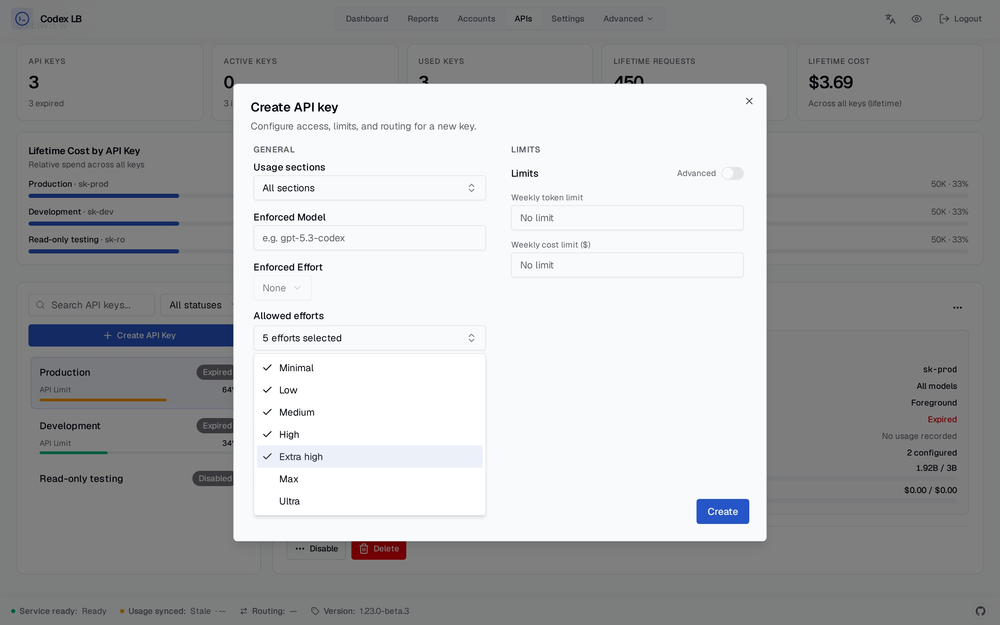

# API Key Authentication

API key auth is **disabled by default**. In that mode, only local requests to the protected proxy routes can
proceed without a key; non-local requests are rejected until proxy authentication is configured. Enable it in
**Settings → API Key Auth** on the dashboard when clients connect remotely or through Docker, VM, or container
networking that appears non-local to the service.

When enabled, clients must pass a valid API key as a Bearer token:

```
Authorization: Bearer sk-clb-...
```

## Protected routes

The protected proxy routes covered by this setting are:

- `/v1/*` (except `/v1/usage`, which always requires a valid key)
- `/backend-api/codex/*`
- `/backend-api/transcribe`

## Creating keys

Dashboard → API Keys → Create. The full key is shown **only once** at creation. Keys support optional expiration, model restrictions, and windowed rate limits for tokens, cost, or credits.

Keys can also be scoped to specific accounts, so a key draws quota only from the accounts assigned to it:


## Credit limits

A `credits` rule is a local per-key budget based on the [published Codex text-token rates](https://learn.chatgpt.com/docs/pricing#token-rates). It does not debit purchased credits or reproduce the exact remaining allowance of a ChatGPT subscription. The dated supported-model rate card lives in `app/core/usage/credit_pricing.py`; unknown models are not assigned a guessed USD conversion rate.

Admission reserves estimated input and output usage. Settlement charges actual token counts, discounts cached input, and keeps the admitted model and requested tier even if the response uses different labels. Fast/Priority uses 2× the Standard credit rate; supported Ultrafast uses 6×. These are purchased-credit multipliers, not included-subscription multipliers. Flex and other unpriced tiers are refused when a credit rule applies. Use a supported model/tier or another limit type for such requests.

Fractions accumulate internally without rounding each request. Existing API fields remain integer whole credits: used credit is rounded down for display, and remaining credit is derived from that display value. A counter can therefore display zero before the first whole credit is consumed. Enforcement uses the precise counter and denies new requests once usage reaches the configured maximum; it does not stop an in-progress response at the exact boundary.

Adding a credit rule without resetting usage reconstructs its current window from that key's non-warmup request logs, including failed requests with reported tokens. Reconstruction uses the logged model and requested tier; an absent requested tier means Standard. Unpriced token-bearing history is rejected instead of treated as free. Editing the maximum preserves existing fractional usage. The existing reset option starts a fresh counter.

**Migration:** pause and drain every application writer before upgrading or downgrading. The migration converts existing credit counters and reservation entries to fractional storage units and adds an internal requested-tier field. Old and new writers cannot share those counters. Existing values outside the signed 64-bit conversion range stop the upgrade before mutation. Downgrade restores whole-credit storage and discards fractions accumulated after upgrade.

## Reasoning effort policies

A key can either enforce one reasoning effort or allow a selected non-empty set of client-requested efforts.
Leave the allowed-efforts selection empty to keep the existing unrestricted behavior. A request that explicitly
sets an effort outside its key's allowlist receives a `403 reasoning_effort_not_allowed` response. Requests that
omit a reasoning effort continue to use the model or upstream default.

The policy evaluates the effort selected by the client, including supported model aliases such as `-xhigh`.
Each configured effort is distinct: allowing `high` does not allow `xhigh`, and allowing `max` does not allow
`ultra`. The proxy still rewrites an allowed `ultra` request to the upstream wire value `max`.



For wiring keys into each client, see [Client Setup](client-setup.md).

---

*Spec: [api-keys](https://github.com/Soju06/codex-lb/tree/main/openspec/specs/api-keys)*
