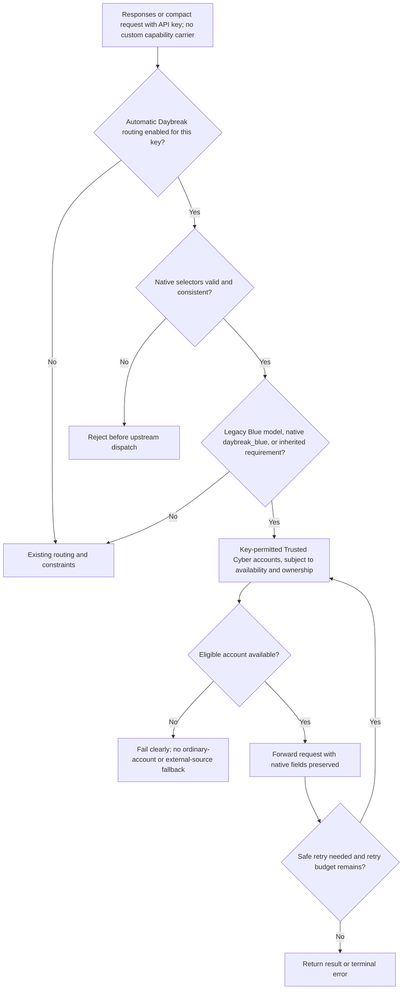
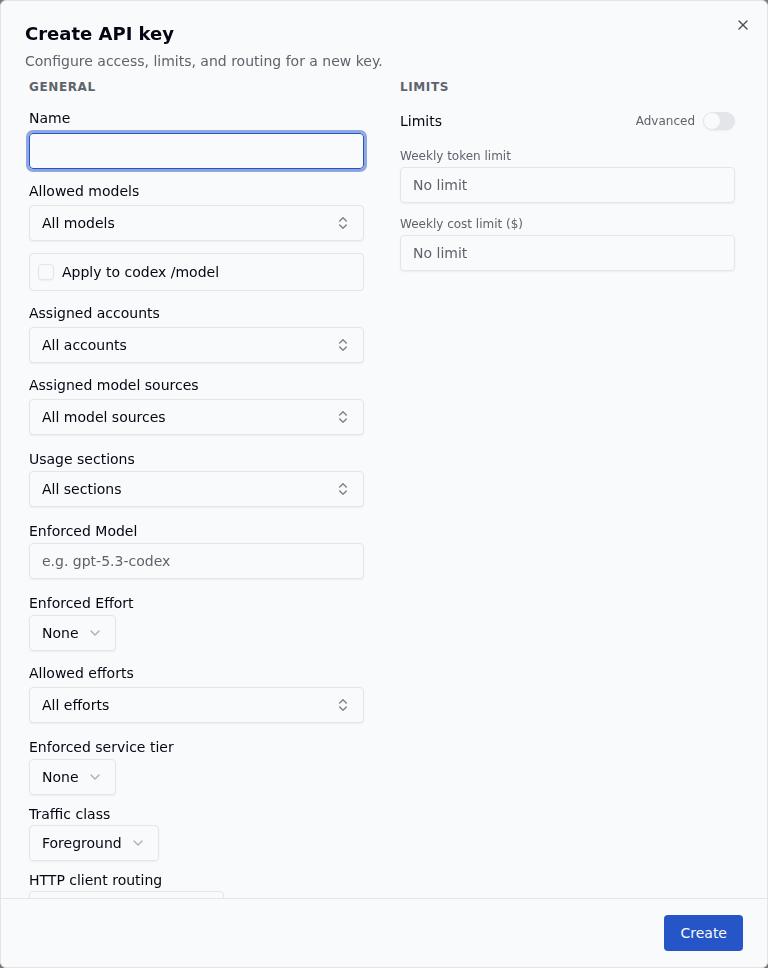
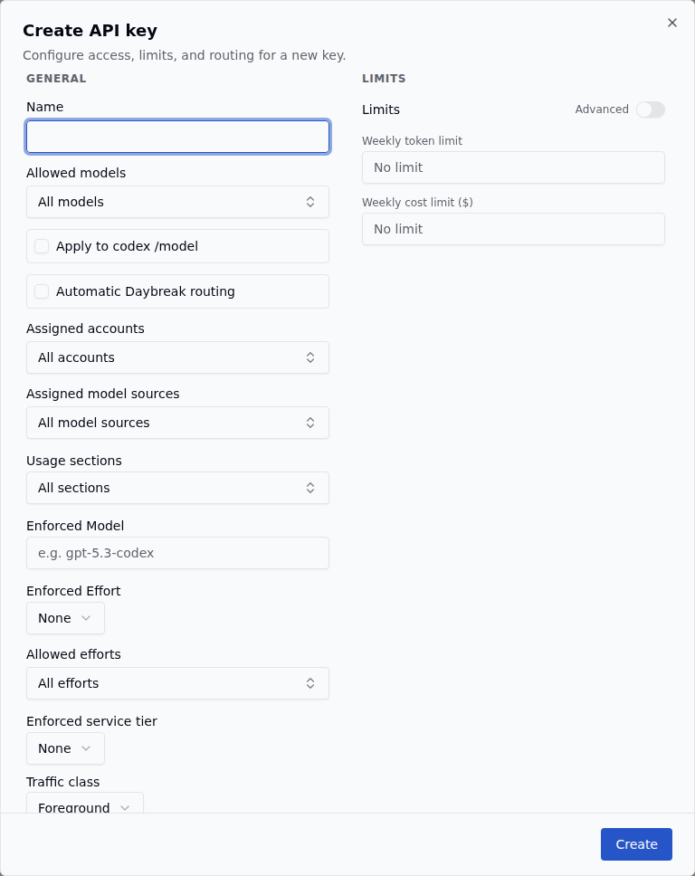

# Automatic Daybreak routing

An operator can enable **Automatic Daybreak routing** when creating or editing an API key. It defaults off for new and existing keys. The existing account-level **Trusted Cyber** flag identifies eligible accounts; it does not grant upstream access.

The diagram follows automatic detection. Existing custom header/metadata carriers retain their WebSocket-only transport contract; they do not enable HTTP routing.

The legacy identifier is `model = "gpt-daybreak-blue-latest"`. The native identifier is `access_programs.cyber = "daybreak_blue"`, which can accompany a general-purpose model. Detection also considers an API-key-enforced legacy model. Malformed, duplicate, unsupported or conflicting selectors fail before dispatch. Daybreak Red is not inferred from Blue eligibility.

The same requirement applies to Responses WebSocket, HTTP Responses and compact. Required HTTP traffic uses the direct subscription transport, bypassing external model sources and the HTTP session bridge. Retry and continuation handling retain key scope, capability lineage and account ownership. An account-owned continuation cannot move to another account merely because it is Trusted Cyber.

For example, a key permits accounts A and B, but only B is Trusted Cyber. An ordinary request uses normal routing. A Blue request can select B while it is available. If B is unavailable, the Blue request fails instead of using A.

## Screenshots

The screenshots compare the Create API key dialog on upstream main (`72630bbfeee9e3b0d9acfb95e2b1e706b8b0188e`) with this feature. They use the repository's synthetic dashboard fixtures and built assets, with the new checkbox unchecked by default.

| Before | After |
| --- | --- |
|  |  |

## Conversation isolation correction

The prior task-wide aliases let one DBB child constrain its ordinary parent and
siblings. Capability requirements now follow an exact conversation and direct
response continuations. For example, task:2 can remain DBB while task:1 and
task:3 retain ordinary routing. Frame window metadata overrides compatibility
headers; thread-id is the fallback before shared session/turn identities.

DBB selection uses the existing thread affinity without seeding the shared
process preference. This prevents DBB-first traffic from pinning later ordinary
work to its account. Ordinary selection, ownership, scope and retry rules stay
in force. A movable mid-session request can select a capable account; an
incompatible account-owned anchor fails closed. Existing exact conversation
markers remain restricted. Broad legacy markers are retained for clients that
lack a specific identity, but do not constrain newly identified conversations.
